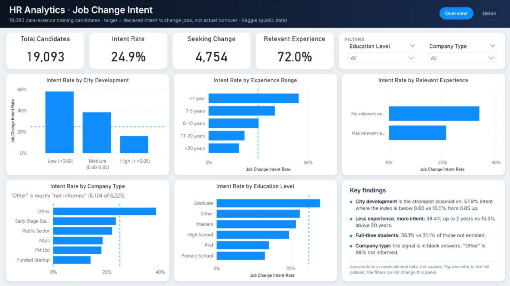
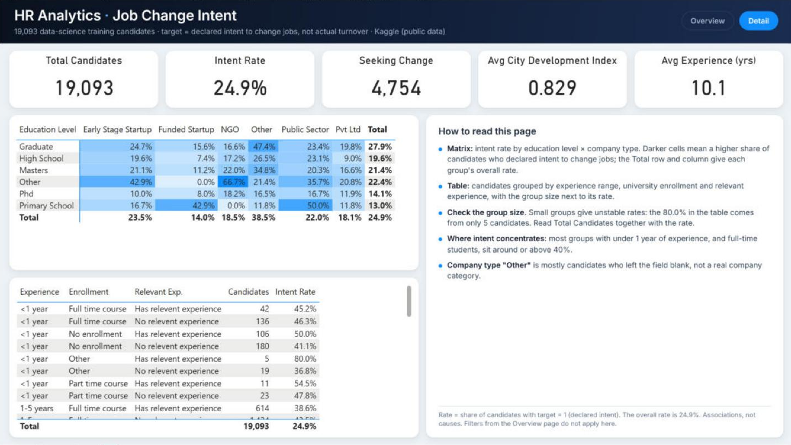
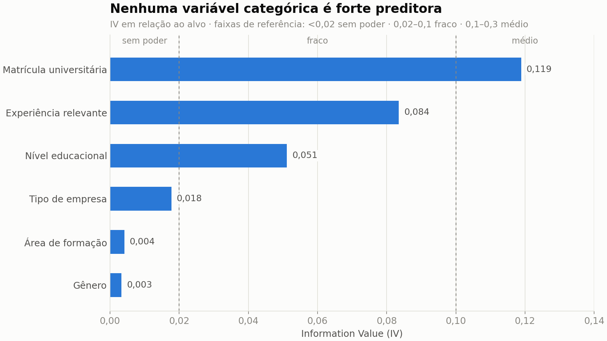
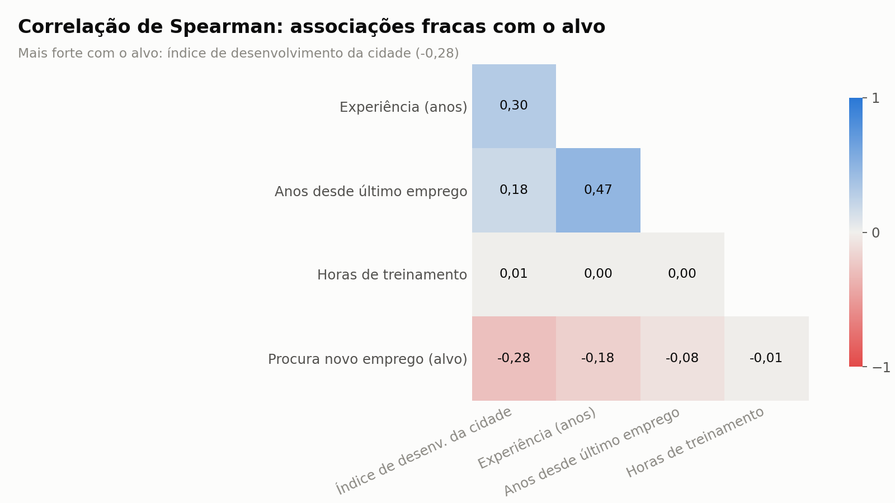
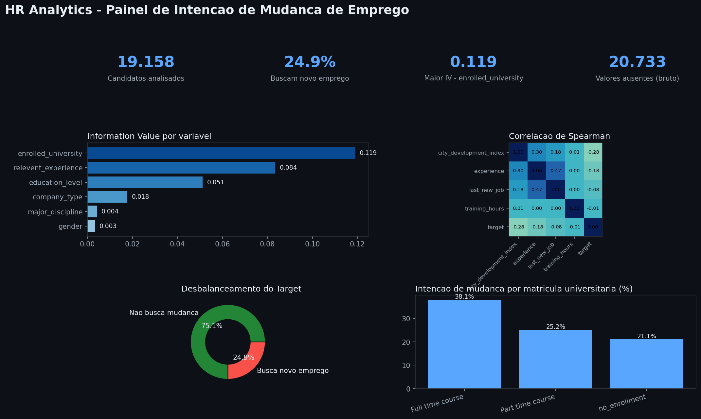

# HR Analytics – Job Change Intent Analysis


Exploratory analysis of 19,158 data-science training candidates to find which characteristics are
**associated with a declared intention to change jobs**, with a Power BI dashboard on the treated data.

> `target = 1` means the candidate **declared** they were looking for a new job when they enrolled.
> It is not a record of an actual resignation, so this project talks about *job change intent*, not turnover.

## Demo




Information Value and Spearman correlation (generated by `src/gerar_figuras.py`):




Exploratory panel generated by the notebook:



## Tech stack

Python (Pandas, NumPy, SciPy, Matplotlib, Seaborn), Jupyter and Power BI Desktop.

## Architecture

```text
dataset/raw/aug_train.csv → ProjetoRH.ipynb (or src/etl.py) → dataset/processed/hr_analytics_tratado.csv → rh.pbix
                          → src/exportar_bi.py → dataset/bi/*.csv (WOE/IV, rates, Spearman)
                          → src/gerar_figuras.py → img/*.png
```

| Path | Content |
|---|---|
| `ProjetoRH.ipynb` | main analysis: EDA, treatment decisions, missing-data tests, robustness checks and report (in Portuguese) |
| `ProjetoRH_v2.ipynb` | same pipeline using the reusable functions in `src/` (in Portuguese) |
| `src/` | `etl.py` (cleaning), `eda.py` (plots, WOE/IV), `exportar_bi.py` (BI tables), `gerar_figuras.py` (README charts) |
| `dataset/raw/` | original Kaggle files ([HR Analytics: Job Change of Data Scientists](https://www.kaggle.com/arashnic/hr-analytics-job-change-of-data-scientists), public and anonymised) |
| `dataset/processed/` | `hr_analytics_tratado.csv` (19,093 rows, 8 columns), output of the notebook and of `src/etl.py` (identical) |
| `dataset/bi/` | auxiliary tables: rate by category, WOE/IV, IV summary, Spearman matrix |
| `rh.pbix` | Power BI dashboard (2 pages) |
| `Dashboard_ProjetoRH.html` | standalone HTML dashboard (Chart.js), opens in any browser |
| `DASHBOARD_BI.md` | DAX of every measure and calculated column |
| `Features.txt` | column dictionary |
| `img/` | dashboard captures |

## Prerequisites and installation

Python 3.12 and, for the dashboard, Power BI Desktop.

```bash
git clone https://github.com/natoawayrj/Initial-HR-Analytics-project.git
cd Initial-HR-Analytics-project
python -m venv .venv
.venv\Scripts\activate            # Windows  (Linux/macOS: source .venv/bin/activate)
pip install -r requirements.txt
```

## How to run

```bash
jupyter nbconvert --to notebook --execute --inplace ProjetoRH.ipynb
```

This regenerates `dataset/processed/hr_analytics_tratado.csv` and `dashboard_hr_analytics.png`.
The modular version can be run without the notebook:

```bash
python -m src.exportar_bi      # dataset/bi/*.csv
python -m src.gerar_figuras    # img/*.png
```

To refresh the dashboard, open `rh.pbix`, go to **Transform data → Data source settings**, point
the source to your `dataset/processed/hr_analytics_tratado.csv` and click **Refresh**.

## Features

### Main findings

Rates are the share of candidates with `target = 1` (overall: 24.9%), computed on the raw training file.

| Variable | Finding |
|---|---|
| City development index (CDI) | Strongest association: 57.9% below 0.60, 38.6% from 0.60 to 0.85, 16.0% from 0.85 up. |
| Years of experience | 38.4% for up to 2 years, 15.3% for more than 20 years. |
| University enrolment | 38.1% for full-time students, 21.1% for those not enrolled. |
| Relevant experience | 33.8% without it, 21.5% with it. |
| Company type | The signal is in the field being **left blank**: 38.8% when missing, 18.4% when filled in. |

These are associations in observational data: they show where the intention is more common, not what causes it.

### Data treatment decisions

| Column | Missing | Decision | Why |
|---|---|---|---|
| `major_discipline` | 2,813 (14.7%) | 2,785 → `Non Degree`, 28 → `Other` | The 2,785 have no degree in `education_level`, so there is no major to report. |
| `enrolled_university` | 386 (2.0%) | 9 → `Primary Grad`, 377 → `Other` | Primary-school candidates cannot be enrolled in university. |
| `company_type` | 6,140 (32.0%) | → `Other` | Missingness is not random, so imputing the mode would mix two different groups. |
| `education_level` | 460 (2.4%) | → `Other` | Few rows and no significant association between missingness and the target. |
| `experience` | 65 (0.3%) | rows dropped | Negligible volume, no defensible rule for an ordinal field. |

Dropped columns: `enrollee_id`, `city`, `gender`, `company_size`, `last_new_job`, `training_hours`.

**Missing data pattern.** A chi-square test of "is the value missing?" against the target shows that
missingness is not random. `company_type` and `company_size` are missing together in 87% of cases,
which suggests people without a current employer. Missing values are therefore kept as their own category.

### Robustness checks (last section of the notebook)

1. **Cramér's V under three treatments** (excluding missing, missing as a category, treated data): stable
   for `enrolled_university` and `education_level`; for `company_type` it goes from 0.05 to 0.22, so its
   signal comes from the blank field.
2. **Category rates before and after treatment:** differences under 0.3 p.p., except `company_type = Other`
   (24.0% with 121 real answers → 38.5% after absorbing the missing values).
3. **Complete-case analysis** (11,708 rows): the overall rate drops from 24.9% to 18.7%, but the direction
   of the CDI, relevant experience and enrolment associations is the same.
4. **Dropping the 65 rows without `experience`** changes the overall rate by less than 0.1 p.p.

### Metrics dictionary (Power BI)

| Measure / column | Definition |
|---|---|
| `Total Candidates` | Number of rows (candidates). |
| `Job Change Intent Rate` | Average of `target`: share of candidates who declared job change intent. |
| `Candidates Seeking Change` | Number of candidates with `target = 1`. |
| `% Relevant Experience` | Share with `Relevant Experience = "Has relevent experience"`. |
| `City Development Band` | Low (< 0.60), Medium (0.60 to < 0.85), High (≥ 0.85). |
| `Experience Range` | <1 year, 1-5, 6-10, 11-20, >20 years. |

In the dashboard, `Company Type = Other` is about 98% "not informed" (6,104 of 6,225 rows), as noted on the chart.

### Limitations

- **Association, not causation.** No confounders were controlled for; CDI, experience and enrolment are related to each other.
- **Intent, not behaviour.** The dataset does not record who actually changed jobs.
- The target is imbalanced (about 75% / 25%) and some categories have few rows, so their rates are unstable.
- Rates are descriptive, one variable at a time. No predictive model was fitted.

## Contributing

Issues and pull requests are welcome. Re-run the notebook before opening a PR so the processed CSV stays in sync.

## Author and license

**Renato Santos** · [LinkedIn](https://www.linkedin.com/in/renato-santos-dados/) ·
[GitHub](https://github.com/natoawayrj) · natoawayrj@gmail.com

Code under the MIT License (see `LICENSE`). The dataset belongs to its Kaggle authors.
