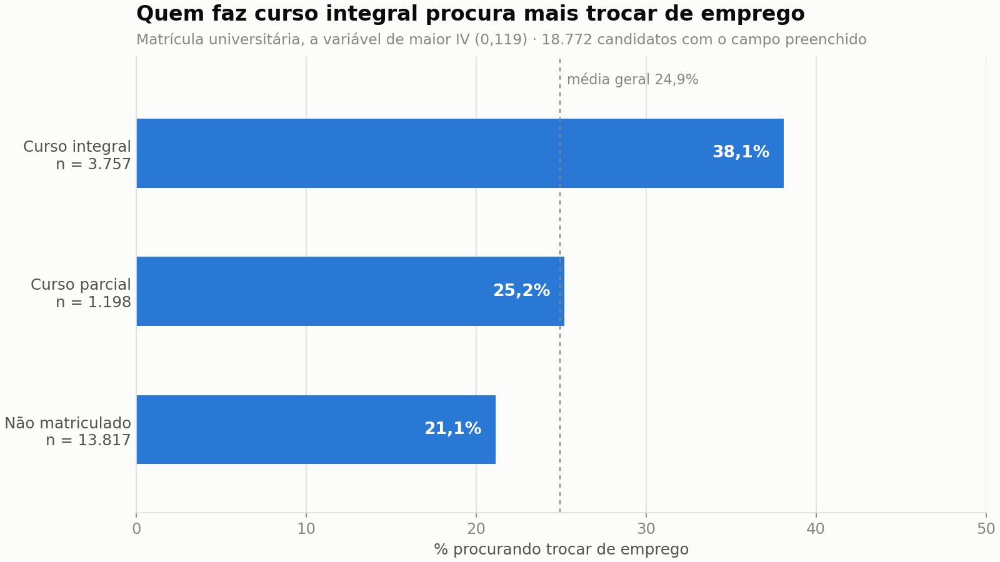
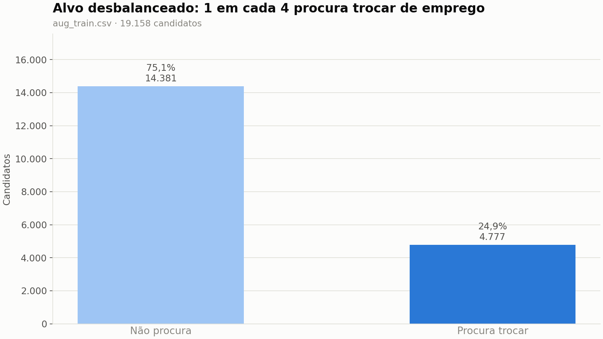

# 📊 HR Analytics - Turnover Analysis

> ✅ Versão atual: **v2** — código refatorado em módulos reutilizáveis, com pipeline de ETL separado da análise. O notebook da v1 foi mantido para referência histórica.

> 📦 **Dados:** [HR Analytics: Job Change of Data Scientists](https://www.kaggle.com/arashnic/hr-analytics-job-change-of-data-scientists) (Kaggle, dataset público). Detalhes na seção [Dados](#-dados).

---

## 🎯 Objetivo

Este projeto tem como objetivo analisar os fatores que influenciam o turnover de funcionários, utilizando técnicas de ETL, análise exploratória de dados (EDA) e métodos estatísticos.

---

## 📌 Problema de negócio

Altas taxas de turnover geram custos significativos para empresas, impactando diretamente produtividade, retenção de talentos e custos operacionais.
Este projeto busca identificar padrões e variáveis associadas à saída de funcionários, auxiliando na tomada de decisão.

---

## 📦 Dados

* **Fonte:** [HR Analytics: Job Change of Data Scientists](https://www.kaggle.com/arashnic/hr-analytics-job-change-of-data-scientists) — Kaggle, publicado pelo usuário `arashnic`. Licença e termos de uso na página do dataset.
* **Contexto:** uma consultoria de Data Science oferece cursos e quer saber quais participantes pretendem trocar de emprego após o treinamento.
* **Período:** não informado pela fonte (base transversal, sem data de coleta).
* **Granularidade:** 1 linha = 1 candidato inscrito no treinamento (`enrollee_id` único, sem duplicidades).
* **Volume:**
  * `aug_train.csv` — 19.158 linhas × 14 colunas (usado na análise)
  * `aug_test.csv` — 2.129 linhas × 13 colunas, **sem** `target` (não usado)
  * `rh_candidatos_limpo.csv` — 19.093 linhas × 8 colunas, após o ETL (65 linhas removidas por `experience` ausente)
* **Variável alvo:** `target` = 1 se o candidato **está procurando trocar de emprego** (24,9%), 0 caso contrário (75,1%). Dicionário completo em `Features.txt`.
* **Limitações conhecidas:**
  * O `target` mede **intenção declarada de mudar de emprego**, não desligamento efetivo. "Turnover" neste projeto é uma aproximação: a análise não observa ninguém saindo de fato.
  * Os candidatos são participantes de um treinamento de uma única empresa — não representam a força de trabalho em geral, nem funcionários de uma empresa específica.
  * Muitos ausentes nas variáveis de empresa: `company_type` (32%), `company_size` (31%) e `gender` (23,5%). As imputações por regra de negócio (`src/etl.py`) criam categorias como `Other`, que misturam casos diferentes.
  * `city` é um código anonimizado e `city_development_index` vem escalonado, sem documentação da métrica original.
  * O sinal é fraco: a variável categórica mais informativa (`enrolled_university`) tem IV 0,119, na faixa de poder preditivo médio, e a numérica mais associada ao alvo (`city_development_index`) tem Spearman −0,28. Nenhuma variável isolada explica a intenção de saída.
  * Análise de associação: nenhum resultado aqui estabelece causalidade.

---

## 📉 Resultados em gráficos

Gerados por `python -m src.gerar_figuras` a partir de `dataset/aug_train.csv`.

**Nenhuma variável categórica é forte preditora.** A mais informativa, matrícula universitária, fica na faixa de poder preditivo médio (IV 0,119); gênero, área de formação e tipo de empresa estão abaixo de 0,02.

**O que a variável de maior IV mostra.** Candidatos em curso integral procuram trocar de emprego com mais frequência (38,1%) do que os não matriculados (21,1%).

**Entre as numéricas, associações fracas com o alvo.** A mais forte é o índice de desenvolvimento da cidade (Spearman −0,28): candidatos de cidades menos desenvolvidas procuram mais trocar de emprego. Horas de treinamento não têm relação com o alvo.

**Alvo desbalanceado.** 24,9% procuram trocar de emprego — relevante para qualquer modelo preditivo futuro.

---

## 🛠️ Tecnologias utilizadas

* Python
* Pandas
* NumPy
* Seaborn / Matplotlib
* Scipy

---

## 🔄 Etapas do projeto

* Limpeza e tratamento de dados (ETL)
* Análise exploratória de dados (EDA)
* Tratamento de valores ausentes com base em regras de negócio
* Conversão de variáveis categóricas
* Análise de distribuição das variáveis
* Análise de correlação (Spearman)
* Aplicação de WOE (Weight of Evidence) e IV (Information Value)

---

## 📊 Insights

* Funcionários com menor experiência apresentam maior tendência de saída
* Algumas variáveis relacionadas à educação demonstram relação com o turnover
* Nem todas as variáveis analisadas possuem impacto significativo
* Variáveis categóricas apresentaram potencial preditivo relevante (WOE/IV)

---

## 💡 Impacto

Os resultados desta análise podem auxiliar equipes de RH a:

* Identificar grupos com maior risco de saída
* Direcionar estratégias de retenção de talentos
* Melhorar a tomada de decisão baseada em dados

---

## 📈 Técnicas utilizadas

* Correlação de Spearman (adequada para dados não paramétricos)
* Weight of Evidence (WOE)
* Information Value (IV)
* Análise de distribuição e comportamento das variáveis

---

## ✨ O que mudou na v2

* ✅ Código refatorado em funções reutilizáveis (`src/etl.py` e `src/eda.py`)
* ✅ Pipeline de ETL separado da análise — uma única chamada (`etl.pipeline_etl`) executa toda a limpeza e grava o dataset limpo
* ✅ Notebook reorganizado em seções claras: Carga → EDA → ETL → Verificação → Relatório
* ✅ Correção de bug da v1: a imputação de `major_discipline` sobrescrevia linhas inteiras com `Other` em vez de apenas a coluna

---

## 🚀 Próximos passos (v3)

* Aprofundar análise orientada a negócio
* Evoluir para um modelo preditivo de turnover (atenção ao desbalanceamento do target)

---

## 📁 Estrutura do projeto

* `ProjetoRH_v2.ipynb` → notebook principal (v2), usa os módulos de `src/`
* `src/etl.py` → pipeline de ETL em funções reutilizáveis (carga, imputação por regras de negócio, gravação)
* `src/eda.py` → funções de análise exploratória (plots, normalidade, Spearman, WOE/IV)
* `src/gerar_figuras.py` → gera os gráficos do README em `img/` (`python -m src.gerar_figuras`)
* `src/exportar_bi.py` → exporta CSVs prontos para o dashboard de BI (`python -m src.exportar_bi`)
* `dataset/bi/` → CSVs de apoio ao BI: tabela fato, taxa de evasão por categoria, WOE/IV e correlação
* `ProjetoRH.ipynb` → notebook da v1 (mantido para referência)
* `Dashboard_ProjetoRH.html` → dashboard interativo com os principais insights
* `Features.txt` → descrição das variáveis do dataset
* `dataset/` → dados utilizados no projeto (inclui `rh_candidatos_limpo.csv` gerado pelo pipeline)

---

## 👨‍💻 Autor

Renato Lázaro Santos Batista
🔗 [LinkedIn](https://www.linkedin.com/in/renato-santos1978/)
